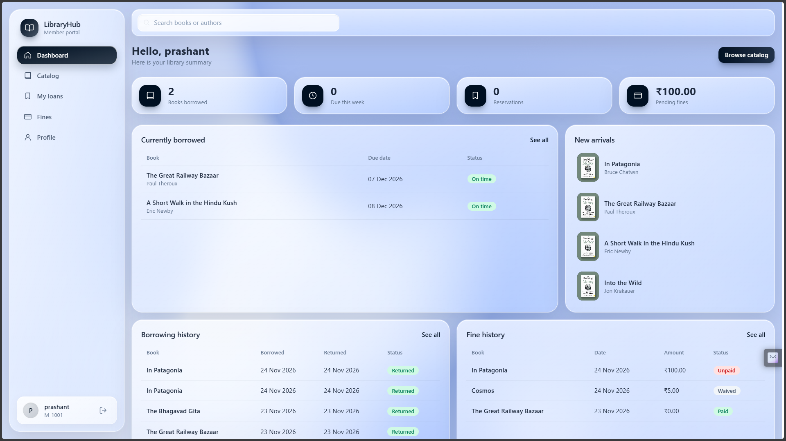
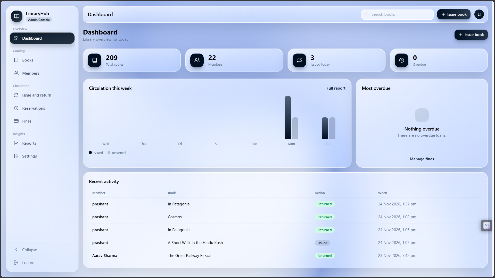

# Libraryhub Frontend




A responsive library-management frontend built with React and Vite. It provides separate experiences for library members and staff, with catalog browsing, loans, reservations, fines, circulation, member management, reporting, and administration settings.

## Contents

- [What the application provides](#what-the-application-provides)
- [Technology stack](#technology-stack)
- [Getting started](#getting-started)
- [Environment configuration](#environment-configuration)
- [Application features](#application-features)
- [Roles and access control](#roles-and-access-control)
- [Backend integration](#backend-integration)
- [Performance and optimization](#performance-and-optimization)
- [Project structure](#project-structure)
- [Data imports](#data-imports)
- [Available commands](#available-commands)
- [Production build](#production-build)
- [Development notes](#development-notes)

## What the application provides

The frontend is organized around two workflows:

- **Member portal**: discover books, view account activity, manage loans and reservations, update profile information, and pay fines.
- **Staff portal**: manage books and categories, members, reservations, issue/return operations, fines, reports, and library rules.

The UI communicates with a separate HTTP API. The frontend uses live API responses when the backend is available; the sample data modules can be used as reference data for the screens and UI states.

## Technology stack

| Area | Technology |
| --- | --- |
| UI | React 19, React DOM |
| Build tool | Vite 8 |
| Styling | Tailwind CSS 4 with `@tailwindcss/vite` |
| Routing | React Router 7 |
| State | Redux Toolkit and React Redux |
| HTTP | Axios |
| Notifications | React Toastify |
| Phone input | `react-phone-number-input` |
| Visual effects | `shaders` |
| Code quality | ESLint and Prettier |

## Getting started

### Prerequisites

- Node.js 18 or newer
- npm 9 or newer
- A running library API server, unless you are only working on static UI changes

### Install and run

```bash
npm install
npm run dev
```

Vite prints the local development URL in the terminal, usually `http://localhost:5173`.

### API requirement

By default, requests are sent to `http://localhost:3000/api`. Start the backend on that address or set `VITE_API_BASE_URL` as described below.

## Environment configuration

Create a `.env.local` file in the project root when the API is not running at the default URL:

```env
VITE_API_BASE_URL=http://localhost:3000/api
```

Only variables prefixed with `VITE_` are exposed to the browser by Vite. Do not put private keys, database credentials, or other secrets in this file.

## Application features

### Member portal

- Member registration and login
- Member dashboard with current loans, new arrivals, borrowing history, reservations, and fine history
- Catalog search by title, author, or ISBN
- Category filtering and book detail pages
- Borrowing and reservation actions
- Active loans, renewals, return requests, and loan history
- Reservation queue and cancellation
- Profile editing and password changes
- Fine listing, payment flow, payment history, and receipt download
- Session expiry handling and automatic access-token refresh

### Staff portal

- Dedicated staff login for librarians and administrators
- Staff dashboard with circulation and library activity summaries
- Book creation, editing, copy management, archiving, and search
- Category creation and import
- Member listing, creation, editing, and spreadsheet import
- Issue and return desk workflow with member lookup
- Reservation review, notification, and cancellation
- Fine creation, payment, and waiver workflows
- Reports with export-to-file support
- Library settings, including renewal, loan duration, and fine rules
- Audit-log access through the admin API

## Roles and access control

The application enforces access at the route level:

| Role | Accessible area |
| --- | --- |
| Member | `/`, `/profile`, `/catalog`, `/catalog/:id`, `/loans`, `/fines` |
| Librarian | `/admin`, `/admin/books`, `/admin/issue`, `/admin/reservations`, `/admin/fines`, `/admin/reports` |
| Administrator | All librarian routes plus `/admin/members` and `/admin/settings` |

Unauthenticated users are redirected to `/login` for member routes and `/admin/login` for staff routes. Authenticated users are redirected away from login pages to the correct role home.

## Backend integration

All requests are centralized through Axios in `src/services/api.js`:

- Adds the stored bearer token to outgoing requests.
- Uses `withCredentials` for cookie-based backend support.
- Refreshes the access token after an eligible `401` response.
- Prevents duplicate refresh requests by sharing one in-flight refresh promise.
- Clears the local session and emits an `auth:logout` event when refresh fails.
- Normalizes API errors through `src/services/apiHelpers.js`.

Feature-specific service modules keep endpoint concerns separate:

| Service | Responsibility | Main endpoints |
| --- | --- | --- |
| `authApi` | Authentication | `/auth/login`, `/auth/register/*`, `/auth/admin/login`, `/auth/refresh` |
| `catalogApi` | Member and staff catalog workflows | `/books`, `/categories`, `/admin/books`, `/admin/categories` |
| `memberApi` | Member account and circulation history | `/me`, `/me/dashboard`, `/me/loans`, `/me/reservations` |
| `circulationApi` | Desk issue/return operations | `/admin/loans`, `/admin/loans/issue`, `/admin/loans/return` |
| `paymentApi` | Member and staff fines | `/me/fines`, `/me/payments`, `/admin/fines`, `/payments/*` |
| `adminApi` | Administration | `/admin/dashboard`, `/user`, `/admin/reservations`, `/admin/settings` |
| `reportApi` | Reports and exports | `/admin/reports/*` |

The frontend expects the backend to return the access token, refresh token, and user object after authentication. Tokens and the serialized user are stored in browser `localStorage` under `token`, `refreshToken`, and `user`.

## Performance and optimization

The project includes the following performance-oriented integrations:

- **Route-level code splitting**: major pages and layouts are loaded with `React.lazy` and rendered through `Suspense`.
- **Vite production bundling**: Vite handles optimized builds, module graph analysis, and asset processing.
- **React compiler integration**: the Vite Babel plugin enables the React compiler preset.
- **Tailwind CSS compilation**: utility styles are compiled through the Tailwind Vite plugin.
- **Request cancellation**: pages pass `AbortSignal` values to Axios requests so unmounted screens do not update state after navigation.
- **Shared authentication refresh**: concurrent `401` responses reuse one refresh request instead of issuing multiple refresh calls.
- **Visibility-aware refresh**: the app checks token freshness on an interval and when the browser tab becomes visible.
- **Blob-based downloads**: templates, reports, and receipts are downloaded as blobs and object URLs are revoked after use.
- **Reusable UI primitives**: shared cards, tables, fields, buttons, tabs, modals, badges, and loading states keep rendering consistent and reduce duplication.

## Project structure

```text
.
├── excel-data/              # Spreadsheet templates and import examples
├── public/                  # Public icons and static files
├── src/
│   ├── assets/              # Bundled visual assets
│   ├── components/          # Shared UI, auth, icon, chart, and toast components
│   ├── data/                # Sample member/admin data used by UI states
│   ├── layouts/             # Member and staff application shells
│   ├── services/            # Axios client and feature API modules
│   ├── store/               # Redux store, slices, and async auth thunks
│   ├── views/Auth/          # Member and staff authentication pages
│   ├── views/Users/         # Member-facing pages
│   ├── views/Admin/         # Staff-facing pages
│   ├── App.jsx              # Routing, guards, lazy loading, token refresh
│   └── main.jsx             # Application entry point
├── index.html
├── package.json
└── vite.config.js
```

## Data imports

The staff screens support spreadsheet-based imports. The repository includes example/template files in [`excel-data/`](./excel-data/):

- `catalog-import-template.xlsx` for book catalog imports
- `library-member-import.xlsx` for member imports
- `member-credentials.xlsx` for member credential data

The UI also requests fresh import templates from the backend and uploads selected files as `multipart/form-data`.

## Available commands

| Command | Purpose |
| --- | --- |
| `npm run dev` | Start the Vite development server |
| `npm run build` | Create a production build in `dist/` |
| `npm run preview` | Serve the production build locally |
| `npm run lint` | Run ESLint across the project |

## Production build

```bash
npm run lint
npm run build
npm run preview
```

Deploy the generated `dist/` directory to a static hosting provider. Configure the host to serve `index.html` as the fallback for client-side routes, and set `VITE_API_BASE_URL` at build time.

## Development notes

- The frontend does not contain the backend implementation or database.
- Authentication and authorization must also be enforced by the backend; client-side route guards are a user-experience and navigation layer, not a security boundary.
- The compatibility barrel in `src/services/libraryApi.js` is retained for older imports. New screens should import the smallest feature-specific service needed.
- There is currently no automated test command in `package.json`; use `npm run lint` and `npm run build` as the baseline validation checks.
